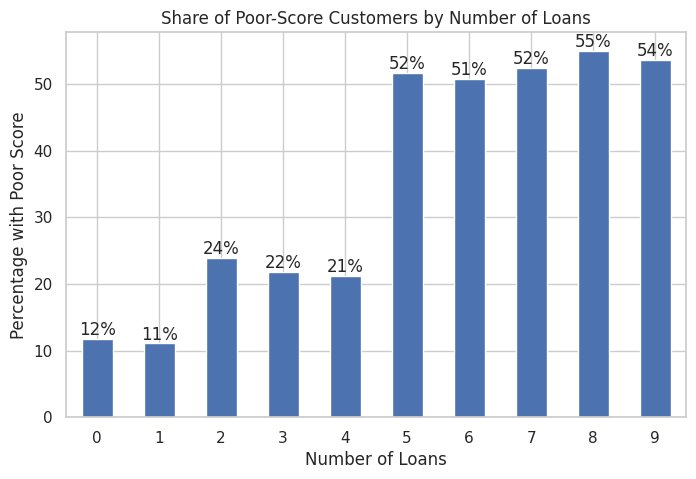
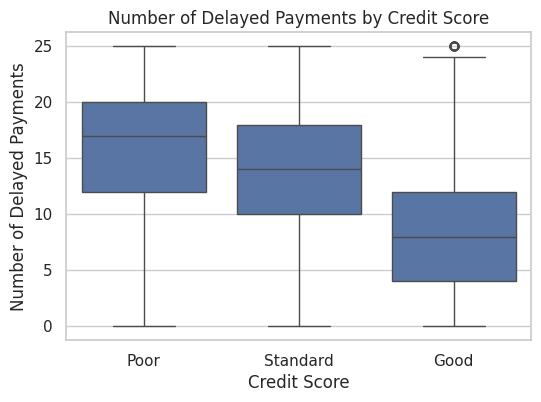
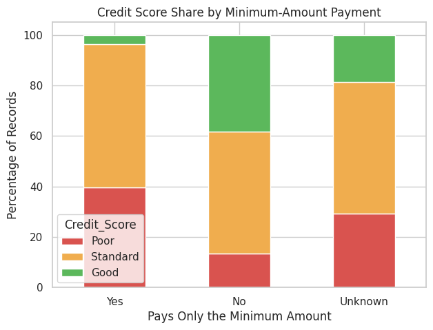
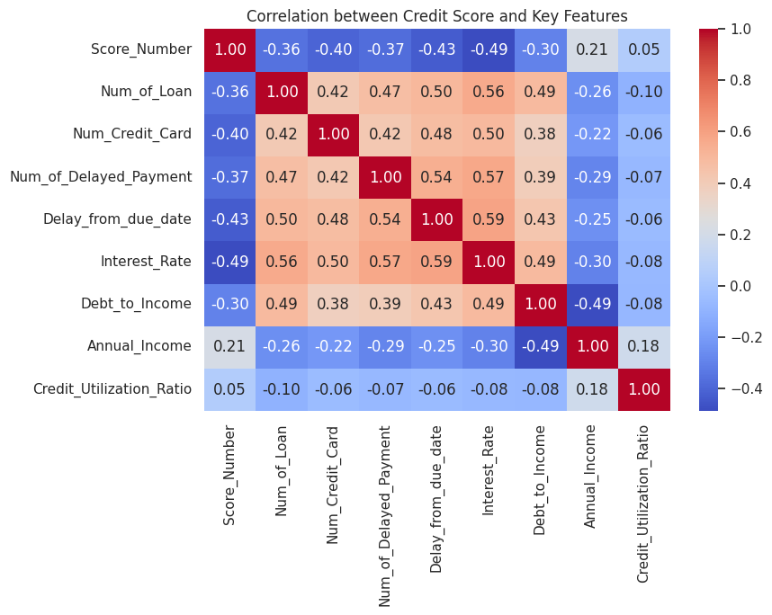

# Paisabazaar Credit Score & Credit Risk Analysis

Exploratory data analysis of 100,000 monthly records of 12,500 Paisabazaar customers, to find which financial behaviours are linked to a Poor, Standard or Good credit score.

## Business Questions
1. Which behaviours separate Poor, Standard and Good credit scores?
2. Does income alone explain credit score?
3. Which customer segment carries the highest risk?

## Key Findings
- **Customers with 5 or more loans are the highest-risk segment.** They make up 30.5% of all records but 55.0% of all Poor-score records, and more than half of them have a Poor score.
- **Payment behaviour separates the score groups clearly.** Poor-score customers average 15.81 delayed payments against 8.56 for Good, and customers who pay only the minimum amount are about 3 times more likely to have a Poor score (39.6% vs 13.4%).
- **Income alone does not explain credit score.** Median income is 32,065 for Poor and 44,928 for Good customers, but the ranges overlap heavily. Debt-to-income separates the groups far better (median 0.063 vs 0.012).
- **Credit utilization shows no real link with score.** It is about 32% in all three groups, so it should not be used alone as a risk signal.

## Selected Charts






## What I Did
- **Data cleaning:** labelled `NM` values in `Payment_of_Min_Amount` as `Unknown` (12,007 rows), checked income outliers (kept, genuine high earners), validated numeric ranges, and dropped `Name` and `SSN` as personal identifiers.
- **Feature engineering:** created `Debt_to_Income` (outstanding debt divided by annual income).
- **Analysis:** 13 charts (univariate, bivariate, multivariate), a Kruskal-Wallis test, and a summary table by credit score.

## Limitations
- Each customer appears 8 times (monthly records), so percentages describe records, not unique customers.
- The analysis shows links, not causes.
- No prediction model was built.

## Project Structure
```
├── data/            # place the dataset here (not included)
├── images/          # charts used in this README
├── notebooks/
│   └── paisabazaar_credit_risk_eda.ipynb
├── requirements.txt
└── README.md
```

## How to Run
1. Download the dataset from <ADD THE LINK WHERE YOU DOWNLOADED IT> and save it as `data/paisabazaar_dataset.csv`. The raw file is not included in this repository because it contains personal-looking identifier columns.
2. Install the libraries: `pip install -r requirements.txt`
3. Open `notebooks/paisabazaar_credit_risk_eda.ipynb` in Jupyter and run all cells.

## Tools
Python, Pandas, NumPy, Matplotlib, Seaborn, SciPy

## Author
Nitin Tiwari
